


<a href="https://linkedin.com/in/laksh-pradhwani" title="Open LinkedIn"></a>






<!-- projects:start -->
<a href="https://github.com/TheRealLaksh/Portfolio-V1" title="Open Portfolio-V1 on GitHub (0 stars)"></a>
<a href="https://github.com/TheRealLaksh/ResumeDeck" title="Open ResumeDeck on GitHub (0 stars)"></a>
<a href="https://github.com/TheRealLaksh/namma-space-r1" title="Open namma-space-r1 on GitHub (0 stars)"></a>
<a href="https://github.com/TheRealLaksh/fetchathon-3-agent" title="Open fetchathon-3-agent on GitHub (0 stars)"></a>
<a href="https://github.com/TheRealLaksh/Vaultara-GovDoc" title="Open Vaultara-GovDoc on GitHub (0 stars)"></a>
<a href="https://github.com/TheRealLaksh/Helios-Music-Player" title="Open Helios-Music-Player on GitHub (1 stars)"></a>
<a href="https://github.com/TheRealLaksh/Callender-Events" title="Open Callender-Events on GitHub (1 stars)"></a>

<!-- projects:end -->






 



